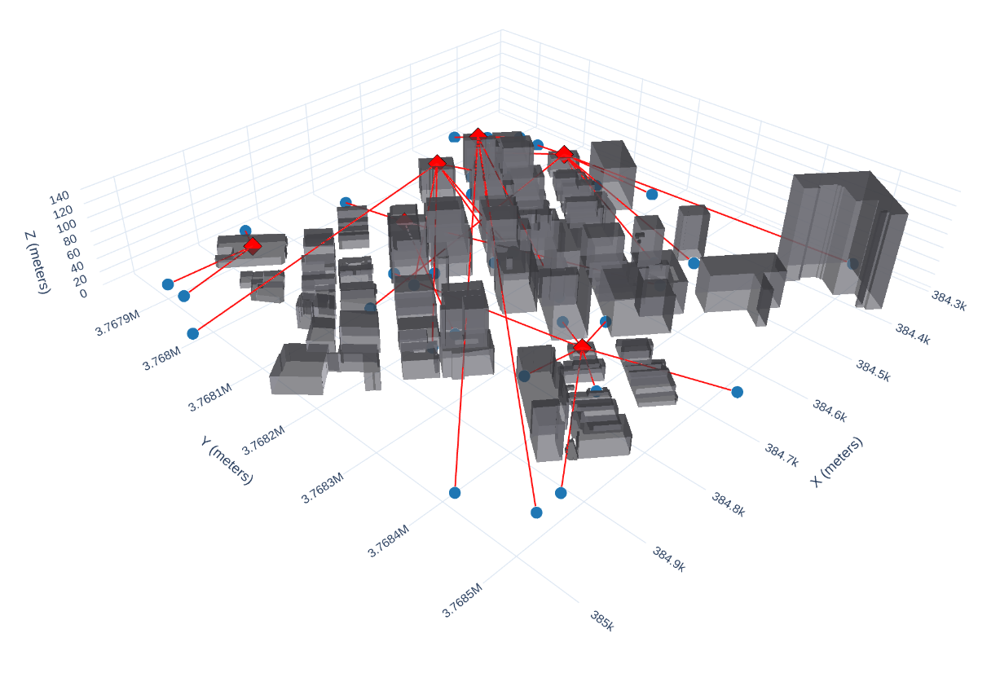

# SOMNUS: Value Decomposition Networks for Energy-Efficient O-RU Sleep Control
This is a vectorized simulation for SOMNUS which implements the system model as described in the paper. Below is a visualization of the imported DTLA topology with base stations positioned in areas of maximum visibility.

The simulation imports geometry from `osmnx` and uses it to calculate LoS propagation. 